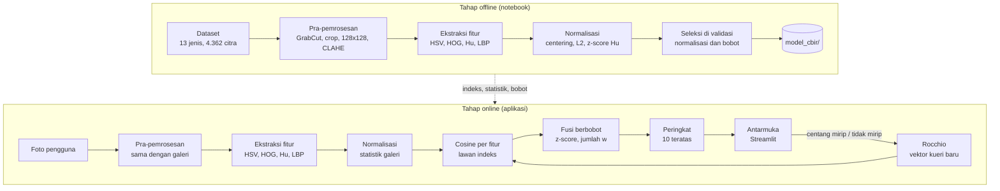
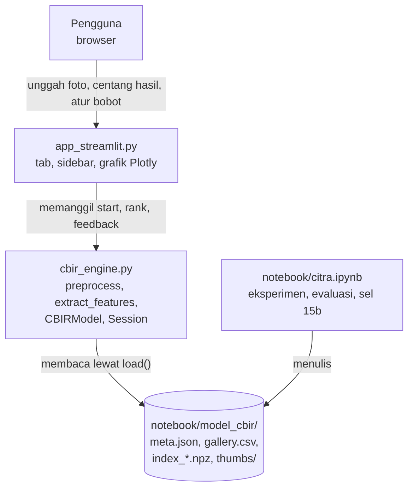

<div align="center">


Unggah satu foto topeng, dapatkan topeng Bali yang paling mirip dari koleksi.

</div>

---

Tugas besar mata kuliah pengolahan citra. Aplikasi ini mencari topeng Bali yang mirip dengan foto yang kita unggah. Pencariannya murni dari isi gambar: warna, bentuk, dan tekstur. Tidak ada model yang dilatih, dan tidak ada kata kunci yang diketik.

Judul lengkap penelitiannya: *Temu Kembali Citra Topeng Tradisional Bali Berbasis Fusi Fitur Warna (HSV), Bentuk (HOG dan Hu Moments), dan Tekstur (LBP) dengan Relevance Feedback pada Balinese Mask Image Dataset*.

## Cara kerjanya

Foto yang diunggah dipotong ke area topengnya dengan GrabCut, lalu dari area itu dihitung empat fitur:

| Fitur | Untuk apa | Panjang vektor |
|---|---|---|
| HSV | warna | 256 |
| HOG | garis dan kontur wajah | 1764 |
| Hu Moments | siluet topeng | 7 |
| LBP | pola permukaan, seperti ukiran | 236 |

Tiap fitur dibandingkan dengan seluruh citra koleksi memakai cosine, nilainya dibakukan (z-score) supaya skalanya sama, lalu dijumlahkan dengan bobot. Bobotnya dipilih dari data validasi, bukan ditebak.

Kalau sepuluh hasil teratas belum pas, kita bisa mencentang mana yang memang mirip. Sisanya dianggap tidak mirip, lalu vektor kueri digeser dengan rumus Rocchio:

```
q' = 1,0 * q + 0,75 * rata-rata(mirip) - 0,15 * rata-rata(tidak mirip)
```

Citra yang sudah dinilai tidak ditampilkan lagi di putaran berikutnya.

Fotonya tidak diberi kotak anotasi. Topeng dicari sendiri oleh GrabCut, supaya kondisinya sama dengan pengguna yang mengunggah foto biasa.

## Arsitektur

Sistemnya dibagi dua tahap. Tahap offline berjalan di notebook dan hanya dilakukan sekali: seluruh citra galeri diproses, fiturnya dihitung dan dinormalisasi, lalu normalisasi serta bobot dipilih memakai data validasi. Hasilnya disimpan ke folder `model_cbir`. Tahap online berjalan di aplikasi setiap kali ada foto baru, dan hanya memakai isi `model_cbir`, jadi tidak ada ekstraksi ulang untuk galeri.



Foto pengguna melewati pra-pemrosesan yang sama dengan galeri, dinormalisasi memakai statistik galeri, lalu dibandingkan dengan indeks. Hasilnya diurutkan dan ditampilkan. Kalau pengguna memberi umpan balik, Rocchio menghasilkan vektor kueri baru dan pencarian diulang dari tahap cosine tanpa mengekstrak fitur lagi.

Dari sisi kode ada tiga lapis. `app_streamlit.py` hanya mengurus tampilan, `cbir_engine.py` berisi seluruh logika pencarian dan tidak tahu apa-apa soal Streamlit, dan `model_cbir` adalah penyimpanan yang dibaca mesin lewat `CBIRModel.load()`. Karena dipisah begitu, mesinnya bisa dipakai dari skrip lain atau diganti antarmukanya tanpa menyentuh logika pencarian.



## Menjalankan

Butuh Python 3.10 ke atas. Dari folder `TuBes`:

```bash
pip install -r requirements.txt
streamlit run app_streamlit.py
```

Isi `requirements.txt`:

```
streamlit>=1.40
plotly
numpy
pandas
opencv-python
scikit-image
```

Aplikasi membaca model dari `notebook/model_cbir` (atau `model_cbir` di samping `app_streamlit.py`). Kalau modelnya di tempat lain, set `CBIR_MODEL_DIR`:

```powershell
$env:CBIR_MODEL_DIR = "D:\data\model_cbir"
streamlit run app_streamlit.py
```

Font aplikasi diambil dari Google Fonts, jadi butuh internet. Tanpa internet aplikasinya tetap jalan, hanya fontnya memakai bawaan browser.

## Membuat modelnya

Folder `model_cbir` dibuat oleh notebook, tidak ada di repositori ini bila terlalu besar.

1. Taruh dataset di folder `dataset/` (sejajar dengan `notebook/`), atau isi `CBIR_DATASET_ROOT`.
2. Jalankan `notebook/citra.ipynb` berurutan sampai sel 15b.
3. Hasilnya muncul di `notebook/model_cbir/`: `meta.json`, `gallery.csv`, dua berkas `index_*.npz`, dan folder `thumbs/`.

Datasetnya diambil dari Kaggle (`sofyan16/citradata`), 13 jenis topeng. Galeri yang tersimpan berisi 4.362 citra.

## Isi aplikasi

Ada empat tab.

- **Cari topeng**: unggah foto, lihat 10 hasil, atur bobot warna/bentuk/tekstur di sidebar, dan kirim umpan balik. Di bawah hasil ada penjelasan fitur apa yang membuat tiap topeng muncul, perkiraan jenis topeng, dan peta kedekatan seluruh koleksi.
- **Cara kerja**: penjelasan tahapan dan rumus.
- **Performa model**: grafik hasil evaluasi dari notebook.
- **Koleksi**: jumlah citra per jenis dan contoh gambarnya.

## Struktur folder

```
TuBes/
  app_streamlit.py     tampilan aplikasi
  cbir_engine.py       ekstraksi fitur, skor, dan Rocchio
  requirements.txt
  .streamlit/config.toml
  docs/banner.svg      gambar di bagian atas README
  dataset/
  notebook/
    citra.ipynb        semua eksperimen dan evaluasi
    model_cbir/        model yang dibaca aplikasi
    cbir_topeng_output/
```

`cbir_engine.py` bisa dipakai sendiri tanpa Streamlit:

```python
from cbir_engine import CBIRModel, decode_image

model = CBIRModel.load("notebook/model_cbir")
sess = model.start(decode_image(open("foto.jpg", "rb").read()))
hasil = model.rank(sess, top_k=10)
sess = model.feedback(sess, relevant_ids=[hasil[0]["id"]])
```

Parameter fitur di `cbir_engine.py` harus sama dengan yang dipakai notebook waktu menyimpan model. Kalau beda, `load()` langsung berhenti dengan pesan error.

## Hasil

Dihitung pada data uji, dengan relevan berarti label yang sama. Skenario 2b adalah yang paling mendekati pemakaian sebenarnya, karena tanpa kotak anotasi.

| Skenario | Model | P@10 | mAP |
|---|---|---:|---:|
| 2 (dengan anotasi) | baseline | 72,99 | 30,38 |
| 2 (dengan anotasi) | model usulan | 77,36 | 35,28 |
| 2b (tanpa anotasi) | baseline | 67,01 | 28,37 |
| 2b (tanpa anotasi) | model usulan | 72,44 | 32,11 |

Umpan balik tiga putaran menaikkan mAP dari 35,28 menjadi 39,58. Pembandingnya pencarian tanpa umpan balik pada galeri sisa yang sama, yang turun ke 29,99. Selisihnya 9,59 poin (interval kepercayaan 95%: 8,59 sampai 10,69).

Ada beberapa hal yang kurang bagus dan sebaiknya ikut dibaca:

- Bobot LBP dan Hu hasil validasi nol, jadi pada praktiknya Model 2 sama dengan Model 1. Fitur tekstur tidak terbukti menambah ketepatan.
- Saat foto diperkecil ke skala 0,8, keunggulan atas baseline hampir hilang.
- Jenis yang berdekatan, terutama tiga Barong, masih sering tertukar.
- Foto dengan latar ramai bisa membuat GrabCut salah memotong, dan hasilnya ikut jelek.

Angka di tab Performa model ditulis langsung di `app_streamlit.py`. Kalau notebook dijalankan ulang dan hasilnya berubah, angka itu harus diubah manual.

## Kalau error

**Folder model tidak ditemukan.** `meta.json` tidak ada di `notebook/model_cbir`. Jalankan notebook sampai sel 15b atau isi `CBIR_MODEL_DIR`.

**`Parameter fitur model tidak sama`.** Konstanta di `cbir_engine.py` berbeda dari notebook. Samakan, atau buat ulang modelnya.

**Thumbnail tidak muncul.** Isi `model_cbir/thumbs/` kosong. Jalankan ulang sel 15b dengan `SAVE_THUMBS = True`.

**Peringatan soal `use_container_width`.** Streamlit-nya terlalu baru atau terlalu lama. Coba `pip install -U streamlit`.

## Catatan

File `index_*.npz` masing-masing sekitar 35 MB, dan folder `dataset/` jauh lebih besar. Kalau repositori ini diunggah ke GitHub, sebaiknya keduanya masuk `.gitignore` atau memakai Git LFS.
